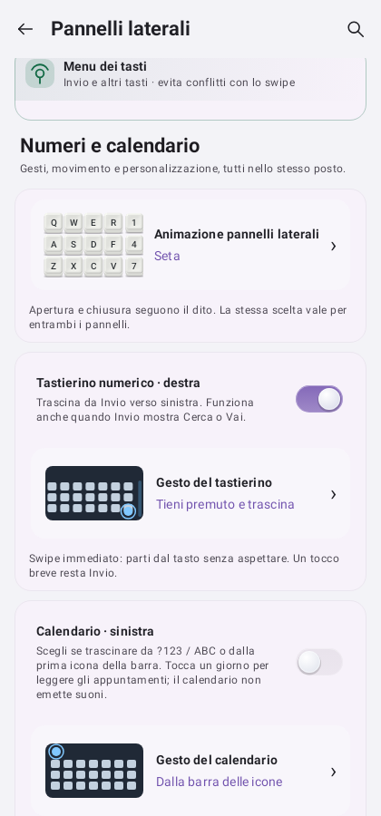
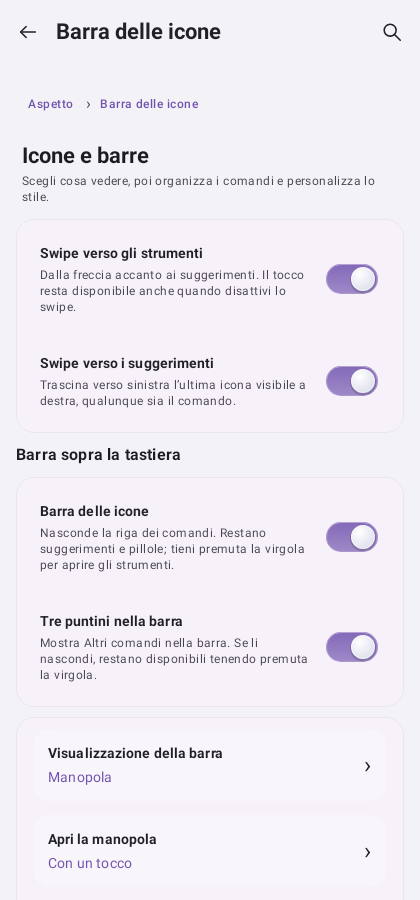
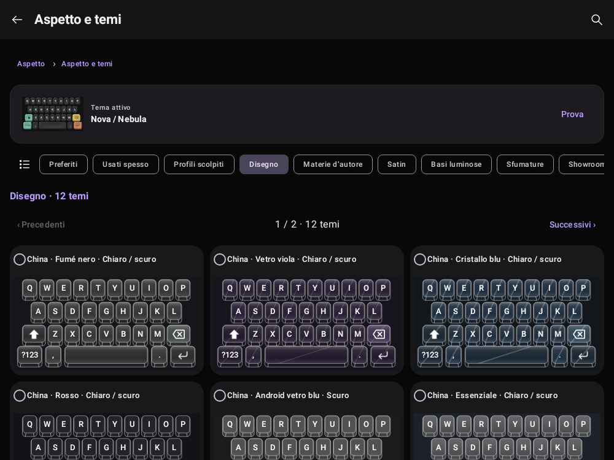
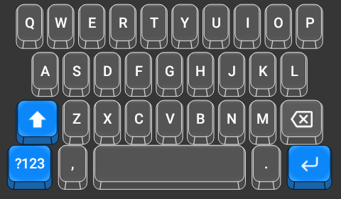
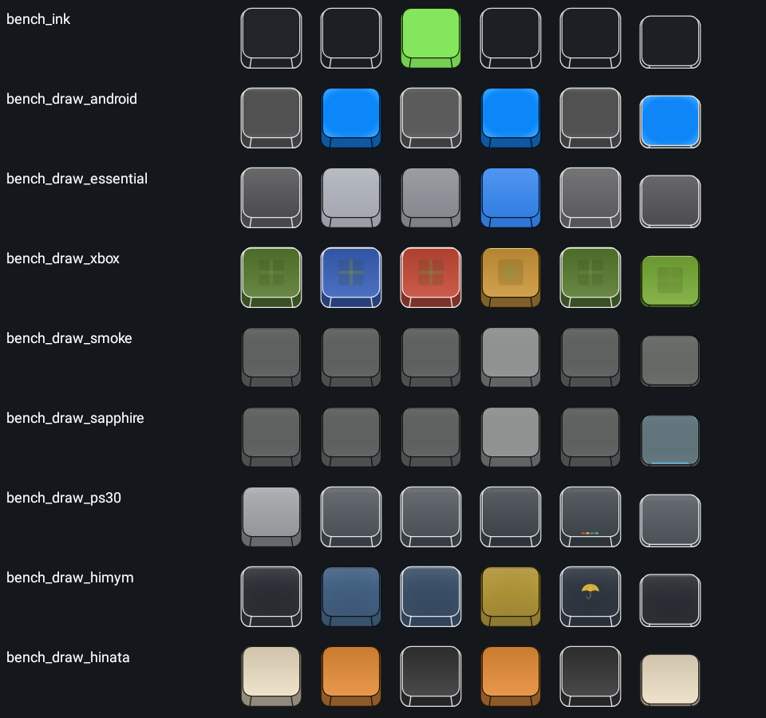

# Interfaccia 0.6.68

Rendering Android generati dai test Robolectric SDK 35 e ispezionati. Sono immagini statiche con dati sintetici: non certificano FPS o comportamento del dispositivo fisico.

## Scelta del gesto

La terza scelta riguarda soltanto il calendario. Le opzioni dei numeri restano indipendenti.

## Barra delle icone

Interruttori condivisi tra questa pagina, Animazioni e Pannelli laterali. La pagina usa gli stessi valori di preferenza, non copie sincronizzate a posteriori.

## Catalogo sul formato ampio

Categorie e quantità chiaramente visibili, anteprime proporzionate. Nessuna deformazione della tastiera per riempire l'intera larghezza.

## Materiali originali, profilo China

Superfici originali con pareti scolpite. Il popup viene verificato pixel per pixel rispetto al tema sorgente. Queste immagini usano le palette predefinite: le personalizzazioni dei tasti dell'utente rimangono separate per tema.

